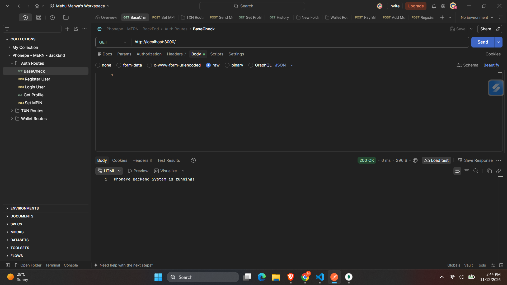
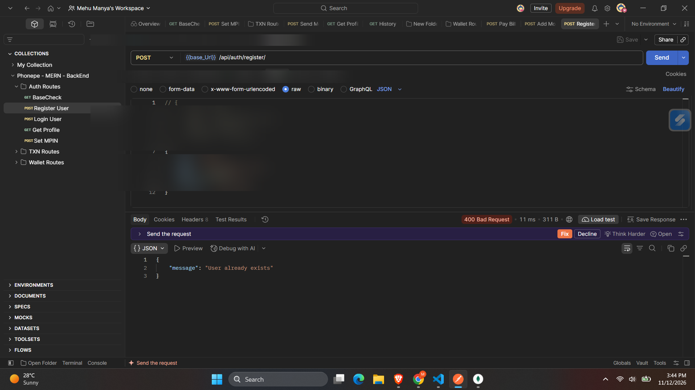
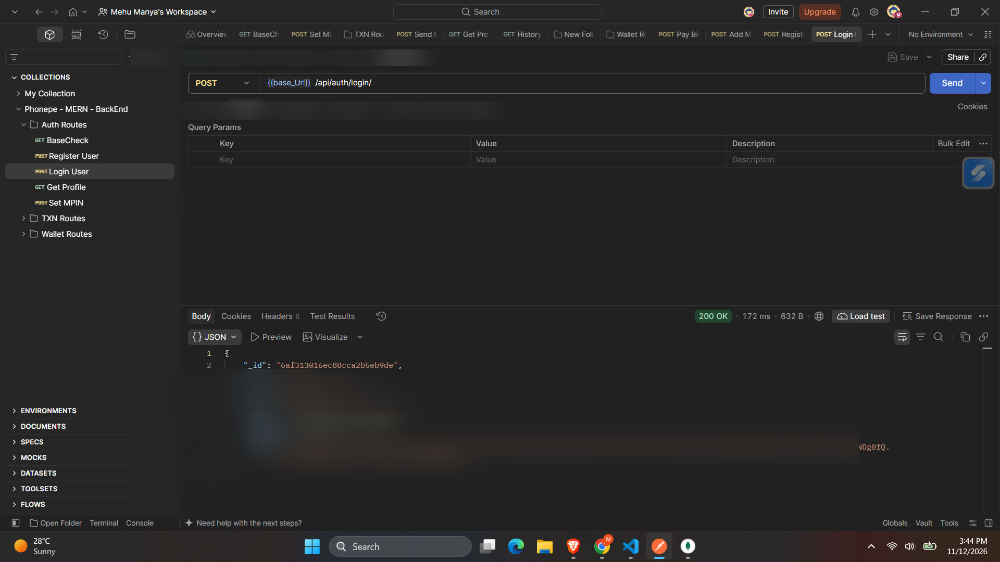
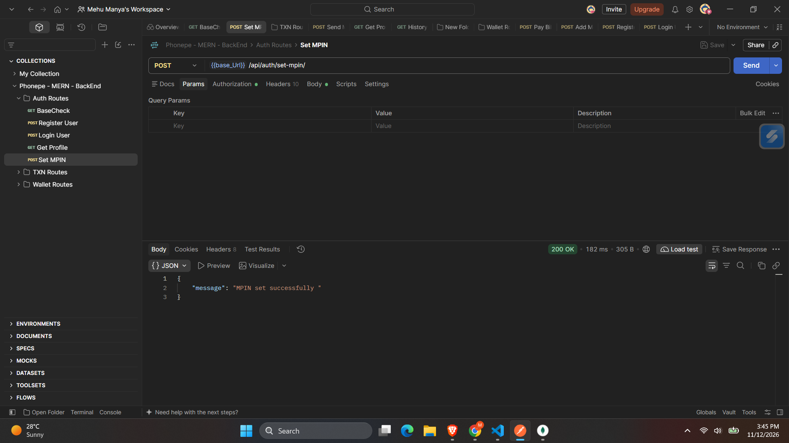
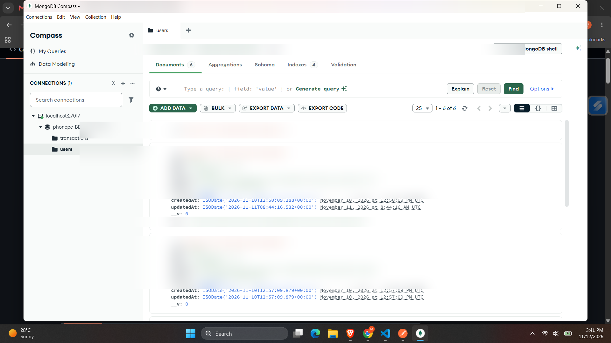
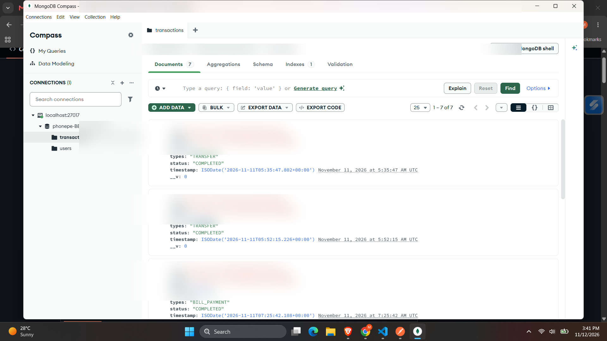
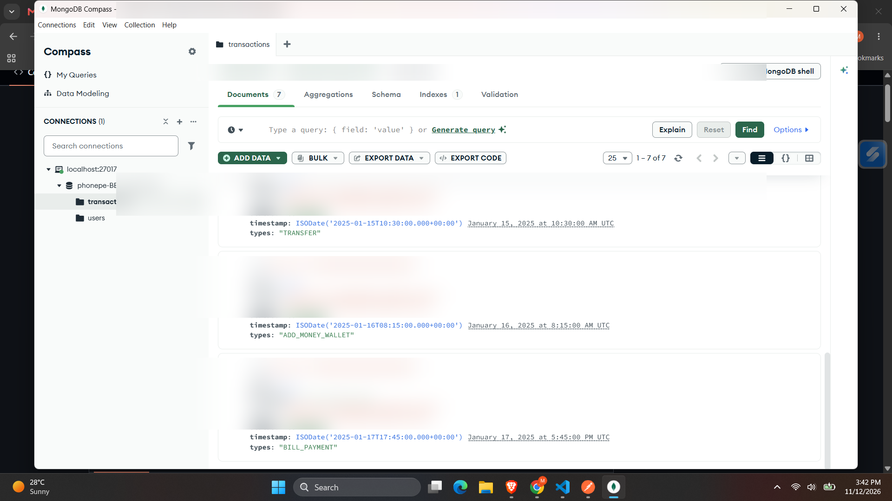
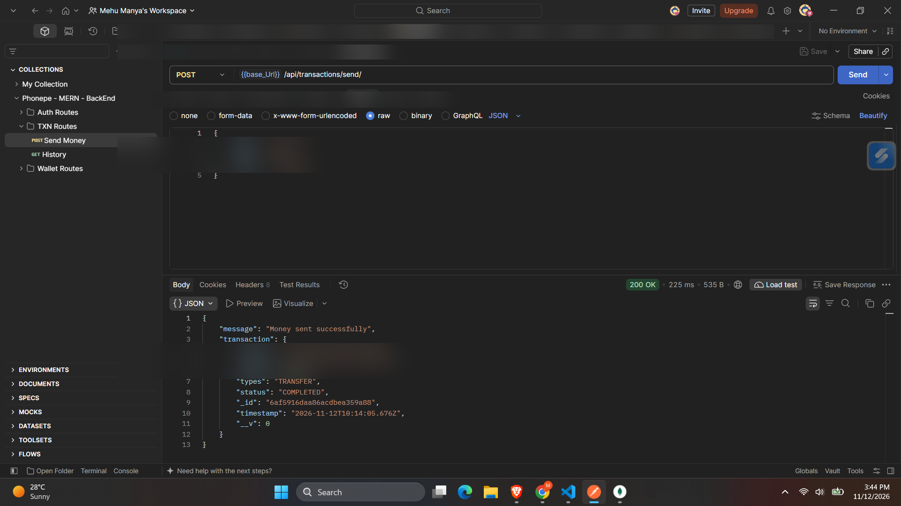
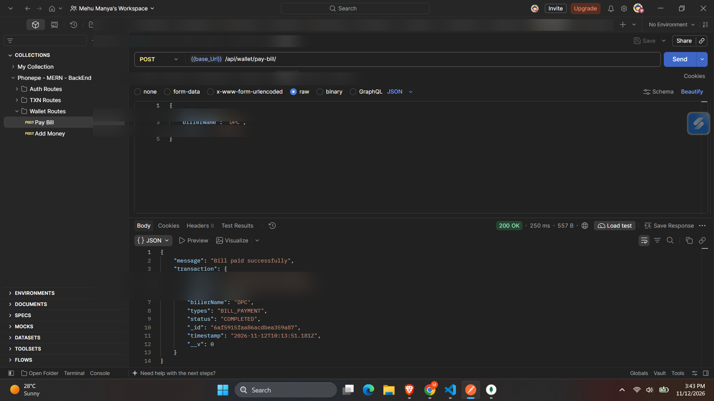
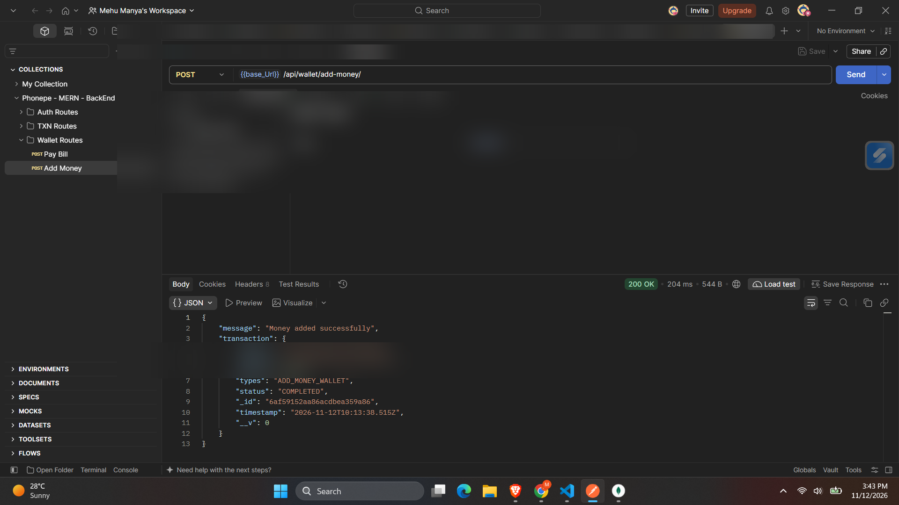

# PhonePe Backend System Clone

A backend application inspired by digital payment platforms, developed using **Node.js, Express.js, and MongoDB**. This project implements essential digital wallet functionalities, including user registration, authentication, MPIN management, money transfers, bill payments, wallet top-ups, and transaction history.

The project focuses on backend development concepts such as REST API design, JWT authentication, database management, password security, and transaction handling.

## Features

### 1. User Authentication
- User registration with name, email, phone number, and password.
- User login using registered credentials.
- JWT-based authentication for protected routes.
- Retrieve the authenticated user's profile.

### 2. MPIN Management
- Set a four-digit MPIN.
- Hash MPIN using bcryptjs before storing it in MongoDB.
- Verify MPIN before processing transactions.

### 3. Wallet Management
- Add money to the user's wallet.
- Make bill payments using the available wallet balance.
- Maintain and update wallet balances.
- Store wallet-related transactions.

### 4. Money Transfers
- Transfer money to another registered user using their phone number.
- Verify MPIN before processing transfers.
- Maintain sender and receiver transaction records.
- Store transaction details in MongoDB.

### 5. Transaction History
- Retrieve transaction records associated with the authenticated user.
- Track transaction types, amounts, status, and timestamps.
- Display sender and receiver details using Mongoose population.

### 6. Database Seeding
- Includes a `seed.js` file to populate MongoDB with demo users and sample transactions.
- Creates three demo users and sample transaction records.
- Supports rerunning the seed script without duplicating existing demo records.

## Tech Stack

| Technology | Purpose |
|---|---|
| Node.js | JavaScript runtime |
| Express.js | Backend framework and REST API development |
| MongoDB | NoSQL database |
| Mongoose | MongoDB object modeling |
| JWT | Authentication and authorization |
| bcryptjs | Password and MPIN hashing |
| Postman | API testing |
| Swagger UI | API documentation |

## Project Structure

```text
PhonePe-Backend-System/
│
├── src/
│   ├── config/
│   │   └── db.js
│   │
│   ├── controllers/
│   │   ├── authController.js
│   │   ├── transactionController.js
│   │   └── walletController.js
│   │
│   ├── middleware/
│   │   └── protect.js
│   │
│   ├── models/
│   │   ├── User.js
│   │   └── Transaction.js
│   │
│   └── routes/
│       ├── authRoutes.js
│       ├── transactionRoutes.js
│       └── walletRoutes.js
│
├── postman/
│   └── Phonepe - MERN - BackEnd.postman_collection.json
│
├── screenshots/
│   ├── server-running.png
│   ├── user-registration.png
│   ├── user-login.png
│   ├── mpin-setup.png
│   ├── mongodb-users.png
│   ├── mongodb-transactions1.png
│   ├── mongodb-transactions2.png
│   ├── money-transfer.png
│   ├── wallet-payment.png
│   └── add-money-wallet.png
│
├── .env.example
├── .gitignore
├── package.json
├── package-lock.json
├── seed.js
├── server.js
├── swagger-output.json
└── README.md
```

## Getting Started

Follow these steps to run the project locally.

### Prerequisites

Make sure you have installed:

- Node.js
- MongoDB (local installation or MongoDB Atlas)
- MongoDB Compass (optional)
- Postman
- Git

### 1. Clone the Repository

```bash
git clone https://github.com/mehu-manya/PhonePe---Backend-System---Clone.git
```

### 2. Navigate to the Project Directory

```bash
cd PhonePe---Backend-System---Clone
```

### 3. Install Dependencies

```bash
npm install
```

### 4. Configure Environment Variables

Create a `.env` file in the root directory using `.env.example` as a reference.

```env
PORT=3000
MONGO_URI=mongodb://localhost:27017/phonepe-BE-system-DEV
JWT_SECRET=your_secret_key
```

Replace the placeholder JWT secret with a secure value.

For MongoDB Atlas, use your own MongoDB connection string as the `MONGO_URI`.

**Note:** The actual `.env` file contains private configuration values and should never be committed to GitHub.

### 5. Start the Backend Server

```bash
npm run dev
```

Once the server starts successfully:

- **Base URL:** http://localhost:3000
- **Swagger API Documentation:** http://localhost:3000/api-docs

## Database Seeding

The project includes a `seed.js` script to populate the database with sample users and transactions for testing purposes.

### Run the Seed Script

First, configure `MONGO_URI` in your `.env` file.

Then execute:

```bash
npm run seed
```

The script creates three demo users and sample transactions in MongoDB.

The seed operation can be rerun without duplicating existing demo records.

**Demo Credentials:**

| Field | Value |
|---|---|
| Password | `Demo1234!` |
| MPIN | `1234` |

The demo password and MPIN are intended only for local development and testing.

## API Endpoints

### Authentication Routes

| Method | Endpoint | Description |
|---|---|---|
| GET | `/` | Check server status |
| POST | `/api/auth/register/` | Register a new user |
| POST | `/api/auth/login/` | Login user |
| GET | `/api/auth/profile/` | Retrieve user profile |
| POST | `/api/auth/set-mpin/` | Set user MPIN |

### Transaction Routes

| Method | Endpoint | Description |
|---|---|---|
| POST | `/api/transactions/send/` | Send money to another user |
| GET | `/api/transactions/history/` | Retrieve transaction history |

### Wallet Routes

| Method | Endpoint | Description |
|---|---|---|
| POST | `/api/wallet/add-money/` | Add money to wallet |
| POST | `/api/wallet/pay-bill/` | Pay bills using wallet balance |

### Authentication

Protected API routes require a JWT token in the Authorization header.

```text
Authorization: Bearer <your_token>
```

## API Testing Using Postman

A Postman collection is included in the `postman/` directory to test the backend APIs.

The collection contains three groups of requests:

- Authentication Routes
- Transaction Routes
- Wallet Routes

### Steps to Test the APIs

1. Open Postman.
2. Import the JSON collection from the `postman/` directory.
3. Configure the `base_Url` variable as `http://localhost:3000`.
4. Start the backend server.
5. Register a new user or use a seeded demo account.
6. Log in and retrieve the JWT token.
7. Configure the token variable in Postman.
8. Test the protected wallet and transaction APIs.

## Application Screenshots

The following screenshots demonstrate the backend server, API operations, and MongoDB database records.

### 1. Backend Server



### 2. User Authentication

**User Registration**



**User Login**



**MPIN Setup**



### 3. MongoDB Database

**User Collection**



**Transaction Collection**





### 4. Wallet and Transaction Operations

**Money Transfer**



**Wallet Payment**



**Add Money to Wallet**



## Database Design

MongoDB is used to store user details and transaction records. Mongoose schemas define the structure of the database documents.

### User Model

Stores the following information:

- Name
- Email
- Phone number
- Hashed password
- UPI ID
- Wallet balance
- Hashed MPIN
- Created and updated timestamps

### Transaction Model

Stores transaction-related information, including:

- Sender
- Receiver
- Transaction amount
- Transaction type
- Transaction status
- Timestamp

## What I Learned

Through this project, I gained practical experience in:

- Structuring backend applications using Node.js and Express.js.
- Designing and developing RESTful APIs.
- Integrating MongoDB with Node.js using Mongoose.
- Implementing JWT-based authentication and protected routes.
- Hashing passwords and MPINs using bcryptjs.
- Managing wallet operations and transaction records.
- Creating database seed scripts for sample data generation.
- Testing APIs using Postman.
- Documenting APIs using Swagger UI.
- Debugging backend errors and handling server responses.

## Future Improvements

- Develop a frontend using React.js.
- Integrate a payment gateway in a sandbox environment.
- Implement stronger transaction validation and security.
- Add automated API and integration testing.
- Improve transaction handling using database transactions.

## Disclaimer

This project is developed for educational and learning purposes. It is an independent implementation inspired by digital payment applications and is not affiliated with or endorsed by PhonePe. It does not represent an official PhonePe service or process real UPI payments.

## Author

**Mehu Manya**

GitHub: [@mehu-manya](https://github.com/mehu-manya)
